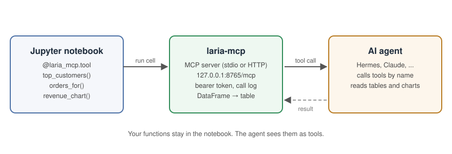
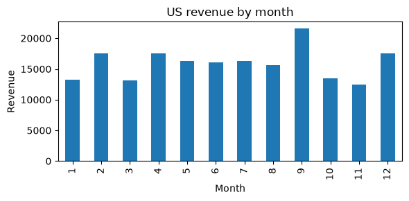
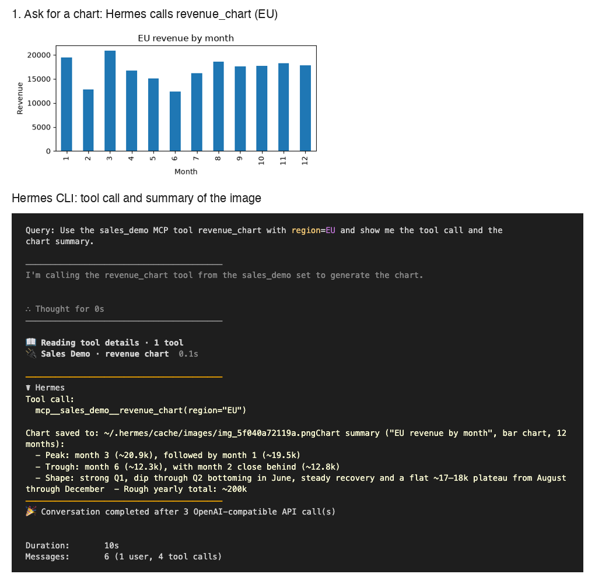
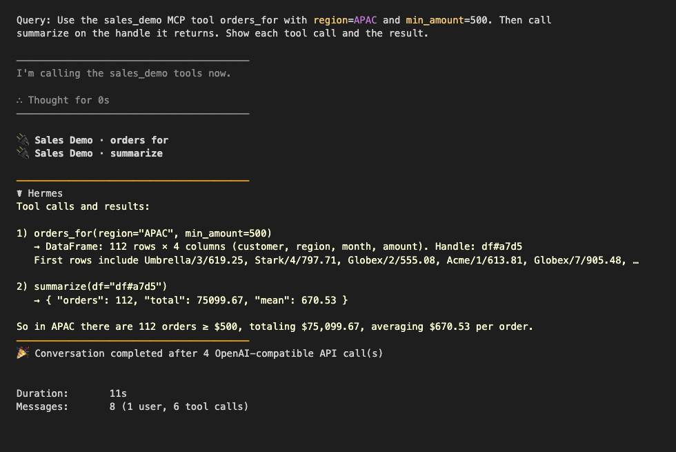
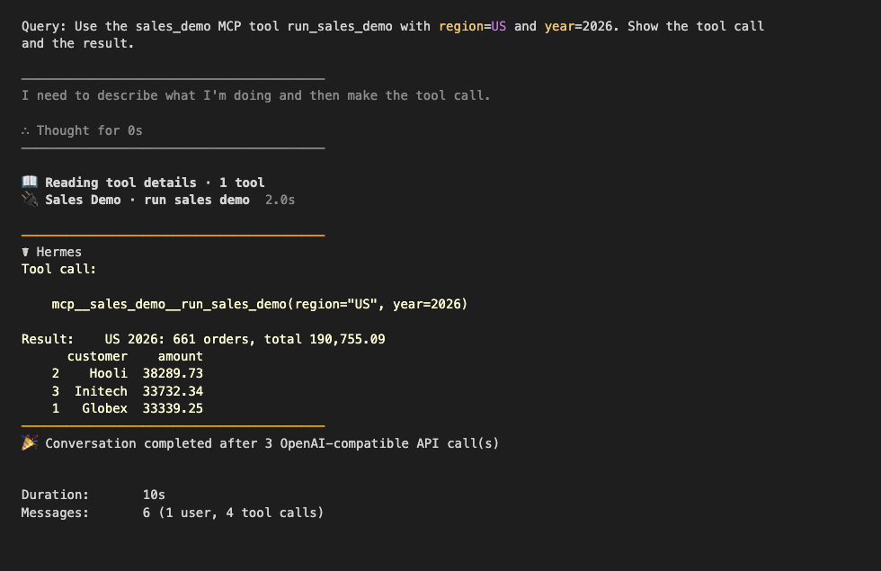
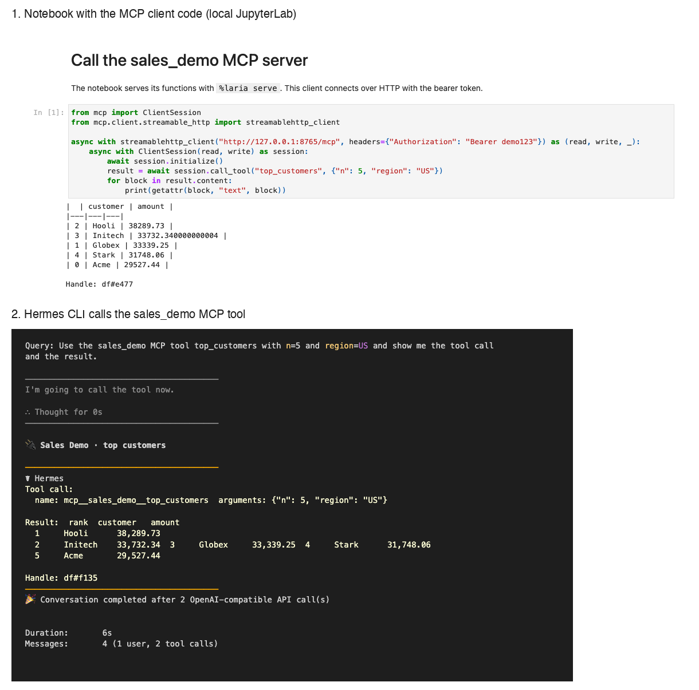

<a id="readme-top"></a>

[![Contributors][contributors-shield]][contributors-url]
[![Forks][forks-shield]][forks-url]
[![Stargazers][stars-shield]][stars-url]
[![Issues][issues-shield]][issues-url]
[![MIT License][license-shield]][license-url]


<!-- PROJECT LOGO -->
<br />
<div align="center">
  <h3 align="center">laria-mcp</h3>

  <p align="center">
    Turn a Jupyter notebook into an MCP server, so AI agents can call its functions as tools.
    <br />
    <a href="https://bebdyshev.github.io/laria-mcp/"><strong>Explore the docs »</strong></a>
    <br />
    <br />
    <a href="https://github.com/bebdyshev/laria-mcp">View Repository</a>
    &middot;
    <a href="https://github.com/bebdyshev/laria-mcp/issues/new?labels=bug">Report Bug</a>
    &middot;
    <a href="https://github.com/bebdyshev/laria-mcp/issues/new?labels=enhancement">Request Feature</a>
  </p>
</div>


<!-- TABLE OF CONTENTS -->
<details>
  <summary>Table of Contents</summary>
  <ol>
    <li>
      <a href="#about-the-project">About The Project</a>
      <ul>
        <li><a href="#built-with">Built With</a></li>
      </ul>
    </li>
    <li>
      <a href="#getting-started">Getting Started</a>
      <ul>
        <li><a href="#prerequisites">Prerequisites</a></li>
        <li><a href="#installation">Installation</a></li>
      </ul>
    </li>
    <li><a href="#usage">Usage</a></li>
    <li><a href="#roadmap">Roadmap</a></li>
    <li><a href="#contributing">Contributing</a></li>
    <li><a href="#license">License</a></li>
    <li><a href="#contact">Contact</a></li>
    <li><a href="#acknowledgments">Acknowledgments</a></li>
  </ol>
</details>


<!-- ABOUT THE PROJECT -->
## About The Project

Notebooks hold the functions and data that people actually work with, but AI agents cannot reach them. laria-mcp serves a notebook's functions as [Model Context Protocol](https://modelcontextprotocol.io) tools, so an agent such as Hermes or Claude can call them directly.

* **Functions become tools.** Top-level functions marked with `@laria_mcp.tool` (or `# @tool`) are exposed with their signatures and docstrings.
* **Results are readable.** DataFrames come back as markdown tables, matplotlib figures as PNG images, and large objects as handles the agent can query again.
* **Live or offline.** Serve a notebook from a running Jupyter kernel with `%laria serve`, or run the notebook headlessly with `laria serve`.
* **Safe by default.** The live server listens only on `127.0.0.1`, requires a bearer token, and can ask for approval on each call.

<div align="center">
  
</div>

<p align="right">(<a href="#readme-top">back to top</a>)</p>


### Built With

* [![MCP][MCP-badge]][MCP-url]
* [![IPython][IPython-badge]][IPython-url]
* [![Jupyter][Jupyter-badge]][Jupyter-url]
* [![Python][Python-badge]][Python-url]

<p align="right">(<a href="#readme-top">back to top</a>)</p>


<!-- GETTING STARTED -->
## Getting Started

Follow these steps to run laria-mcp with a notebook on your machine.

### Prerequisites

* Python 3.10 or newer
* A Jupyter environment (JupyterLab or Notebook) for live mode
* An MCP client, for example [Hermes](https://github.com/NousResearch/hermes-agent)

### Installation

1. Install the package from PyPI
   ```sh
   pip install laria-mcp
   ```
2. Serve a notebook to an agent over stdio
   ```sh
   laria serve analysis.ipynb
   ```
3. Or write the agent's config for a live Jupyter session
   ```sh
   laria hermes-config analysis.ipynb --live --token <random string>
   ```
   This adds the server to `~/.hermes/config.yaml` and keeps a backup of the old file.

For the full setup guide (live mode, Hermes, JupyterHub), see the [documentation](https://bebdyshev.github.io/laria-mcp/).

<p align="right">(<a href="#readme-top">back to top</a>)</p>


<!-- USAGE EXAMPLES -->
## Usage

In a notebook, load the extension and start a live server:

```python
%load_ext laria_mcp
%laria serve --token <random string>
```

Mark the functions you want to expose:

```python
import laria_mcp

@laria_mcp.tool
def top_customers(n: int = 5, region: str = "EU"):
    """Return the n customers with the highest revenue in a region."""
    ...
```

Then restart the agent so it loads the new server. Example questions: *"find top 5 US customers from sales_demo"*.

When a tool returns a matplotlib figure, the agent receives it as a PNG. For example, `revenue_chart(region="US")` from the demo notebook returns:

<div align="center">
  
</div>

A complete example notebook is in [`examples/sales_demo.ipynb`](examples/sales_demo.ipynb). For more examples, see the [documentation](https://bebdyshev.github.io/laria-mcp/).

<p align="right">(<a href="#readme-top">back to top</a>)</p>


<!-- USE CASES -->
## Use Cases

The screenshots below come from the demo notebook (`examples/sales_demo.ipynb`), run locally with Hermes as the agent.

### Ask for a chart

The agent calls `revenue_chart`, receives the figure as an image, and describes it.

<div align="center">
  
</div>

### Chain tools through a handle

`orders_for` returns a large result as a handle (`df#…`) instead of pasting the rows. The agent passes that handle to `summarize`, so the data never has to fit in the conversation.

<div align="center">
  
</div>

### Run the whole notebook with parameters

A cell tagged `parameters` turns the notebook into a tool. The agent passes new values and gets the result of the full run back.

<div align="center">
  
</div>

### Call the tools from your own code

Any MCP client can use the same server. A small notebook can connect over HTTP with the token and call a tool directly.

<div align="center">
  
</div>

<p align="right">(<a href="#readme-top">back to top</a>)</p>


<!-- ROADMAP -->
## Roadmap

- [x] Serve notebook functions as MCP tools over stdio and streamable HTTP
- [x] Live mode with `%laria serve`, hot reload and call log
- [x] Hermes config generator (`laria hermes-config`)
- [x] Publish to PyPI
- [ ] Verify an agent tool call end to end on the course JupyterHub
- [ ] Review the notebook loader (`src/laria_mcp/loader.py`)
- [ ] Support more MCP clients

See the [open issues](https://github.com/bebdyshev/laria-mcp/issues) for a full list of proposed features and known issues.

<p align="right">(<a href="#readme-top">back to top</a>)</p>


<!-- CONTRIBUTING -->
## Contributing

Contributions make the open source community a great place to learn and create. Any contributions you make are **greatly appreciated**.

1. Fork the Project
2. Create your Feature Branch (`git checkout -b feature/AmazingFeature`)
3. Commit your Changes (`git commit -m 'Add some AmazingFeature'`)
4. Push to the Branch (`git push origin feature/AmazingFeature`)
5. Open a Pull Request

For development, install the package with its dev extra (`pip install -e ".[dev]"`) and run `pytest`.

### Top contributors:

<a href="https://github.com/bebdyshev/laria-mcp/graphs/contributors">
  
</a>

<p align="right">(<a href="#readme-top">back to top</a>)</p>


<!-- LICENSE -->
## License

Distributed under the MIT License. See `LICENSE` for more information.

<p align="right">(<a href="#readme-top">back to top</a>)</p>


<!-- CONTACT -->
## Contact

Team group27, cs1302a - [GitHub Issues](https://github.com/bebdyshev/laria-mcp/issues)

Project Link: [https://github.com/bebdyshev/laria-mcp](https://github.com/bebdyshev/laria-mcp)

<p align="right">(<a href="#readme-top">back to top</a>)</p>


<!-- ACKNOWLEDGMENTS -->
## Acknowledgments

* [Model Context Protocol](https://modelcontextprotocol.io)
* [Hermes Agent](https://github.com/NousResearch/hermes-agent)
* [Best-README-Template](https://github.com/othneildrew/Best-README-Template)
* [Img Shields](https://shields.io)


<!-- MARKDOWN LINKS & IMAGES -->
[contributors-shield]: https://img.shields.io/github/contributors/bebdyshev/laria-mcp.svg?style=for-the-badge
[contributors-url]: https://github.com/bebdyshev/laria-mcp/graphs/contributors
[forks-shield]: https://img.shields.io/github/forks/bebdyshev/laria-mcp.svg?style=for-the-badge
[forks-url]: https://github.com/bebdyshev/laria-mcp/network/members
[stars-shield]: https://img.shields.io/github/stars/bebdyshev/laria-mcp.svg?style=for-the-badge
[stars-url]: https://github.com/bebdyshev/laria-mcp/stargazers
[issues-shield]: https://img.shields.io/github/issues/bebdyshev/laria-mcp.svg?style=for-the-badge
[issues-url]: https://github.com/bebdyshev/laria-mcp/issues
[license-shield]: https://img.shields.io/github/license/bebdyshev/laria-mcp.svg?style=for-the-badge
[license-url]: https://github.com/bebdyshev/laria-mcp/blob/main/LICENSE
[MCP-badge]: https://img.shields.io/badge/MCP-000000?style=for-the-badge
[MCP-url]: https://modelcontextprotocol.io
[IPython-badge]: https://img.shields.io/badge/IPython-76B900?style=for-the-badge&logo=ipython&logoColor=white
[IPython-url]: https://ipython.org
[Jupyter-badge]: https://img.shields.io/badge/Jupyter-F37626?style=for-the-badge&logo=jupyter&logoColor=white
[Jupyter-url]: https://jupyter.org
[Python-badge]: https://img.shields.io/badge/Python-3776AB?style=for-the-badge&logo=python&logoColor=white
[Python-url]: https://www.python.org
