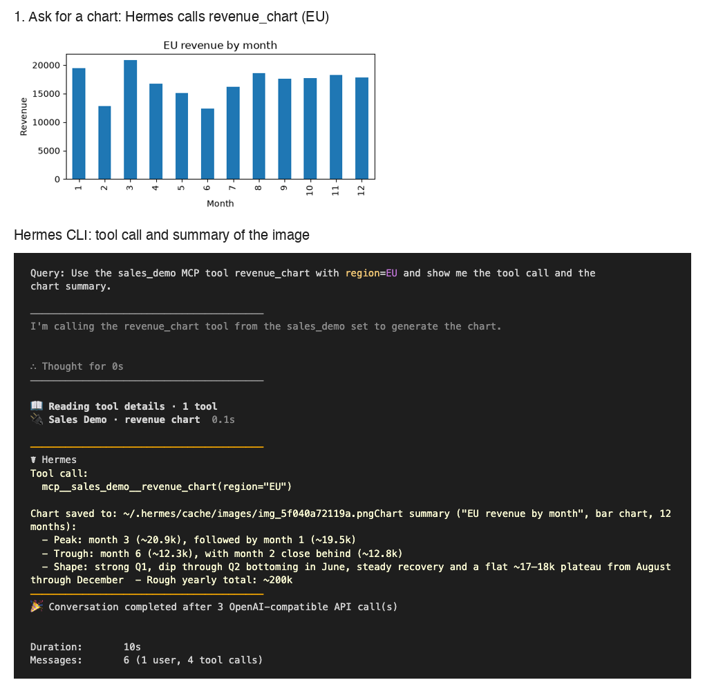
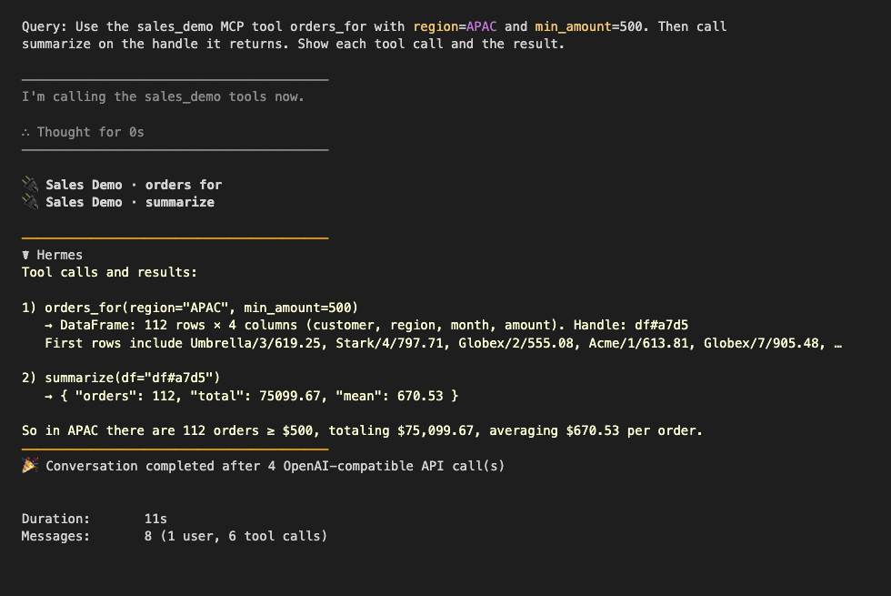
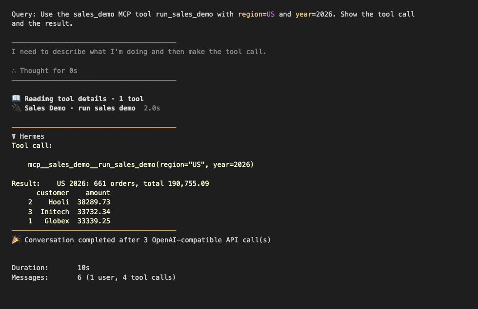
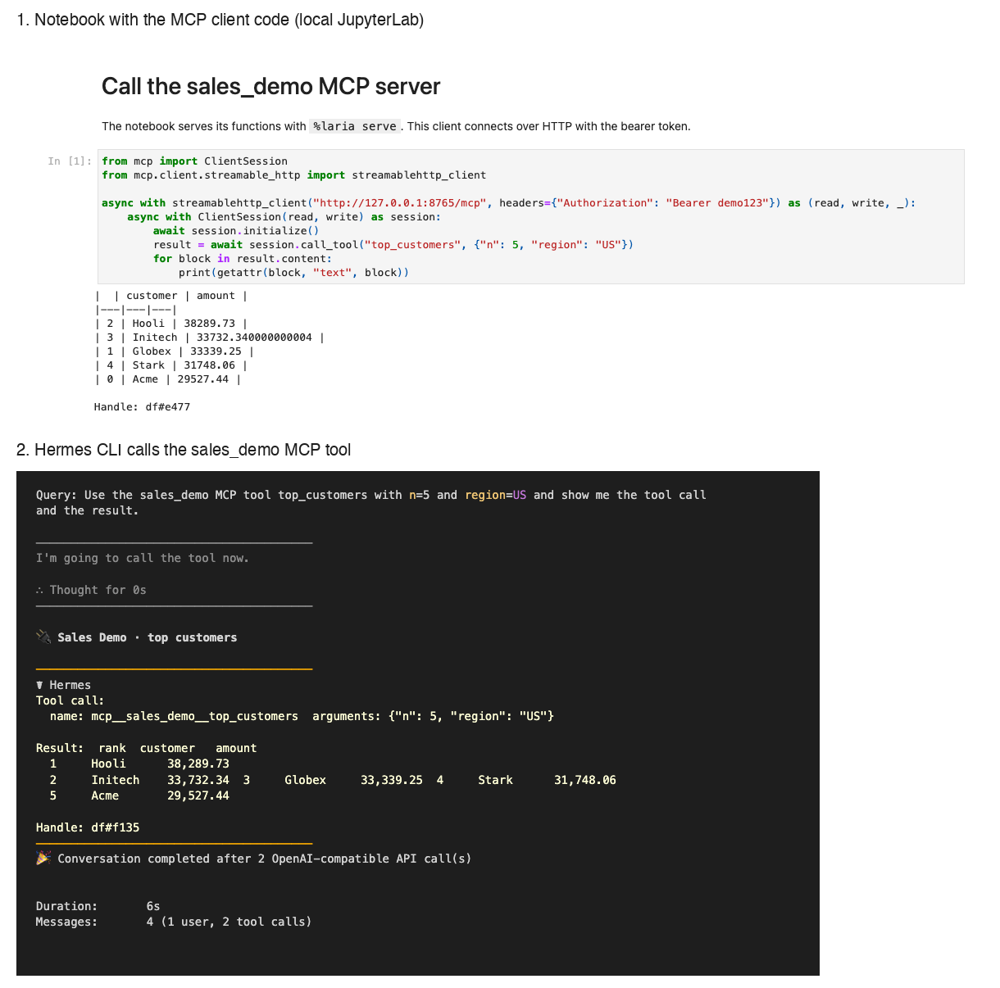
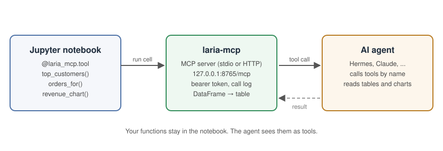

# laria-mcp

**Group 27, cs1302a.** Team: Kerey, Bibek, Matthias, Vladan, Daniil, Namlahang.

- PyPI: https://pypi.org/project/laria-mcp/
- Repository: https://github.com/bebdyshev/laria-mcp
- Documentation: https://bebdyshev.github.io/laria-mcp/
- 60-second demo script: https://github.com/bebdyshev/laria-mcp/blob/main/docs/demo-script.md

## Motivation

A Jupyter notebook holds the functions and data people actually work with, but AI agents cannot reach them. Copying results into a chat is slow and loses the code that produced them.

## Innovation

**laria-mcp** turns a notebook into a [Model Context Protocol](https://modelcontextprotocol.io) server. Functions marked with `@laria_mcp.tool` become tools that an agent such as Hermes can call.

- **Live from the kernel:** `%laria serve` exposes the notebook's current state, so edits and new results are visible to the agent.
- **Readable results:** DataFrames come back as tables, matplotlib figures as images, and large results as handles (`df#...`) that other tools can use.
- **Notebook as a tool:** a cell tagged `parameters` makes the whole notebook callable with new values.
- **Safe by default:** the server listens on `127.0.0.1`, requires a bearer token, and can ask for approval on each call.

## Installation and usage

```sh
pip install laria-mcp

# serve a notebook to an agent over stdio
laria serve analysis.ipynb

# or, inside Jupyter
%load_ext laria_mcp
%laria serve --token <random string>
```

Then point the agent at the server. For Hermes, `laria hermes-config analysis.ipynb --live --token <string>` writes the entry to `~/.hermes/config.yaml` and keeps a backup of the old file.

## Use cases

**1. Ask for a chart.** The agent calls `revenue_chart`, receives the image, and describes it.



**2. Chain tools.** `orders_for` returns a handle, and `summarize` reads it without the rows entering the conversation.



**3. Run the whole notebook with new parameters**, for example `run_sales_demo(region="US", year=2026)`.



**4. Call the same server from your own code.** Any MCP client can use it. Left: client code in a separate notebook. Right: the Hermes CLI calling the tool.



## Architecture



Functions stay in the notebook. The agent sees them as tools.

## Testing and status

- 80 tests in CI (Python 3.10, 3.11, 3.12), run on every push to `main`.
- Published to PyPI as version 0.1.1; installs on the course JupyterHub.
- Verified on a laptop: Hermes calls the notebook's tools and gets the results.

**Open item:** on the course JupyterHub the server starts and accepts calls, but the Hermes model installed there does not complete tool calls, so the agent demo was recorded on a laptop.

## Team

Group 27: Kerey, Bibek, Matthias, Vladan, Daniil, Namlahang. Licensed under the MIT License.
